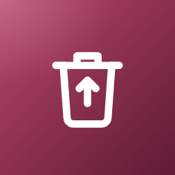
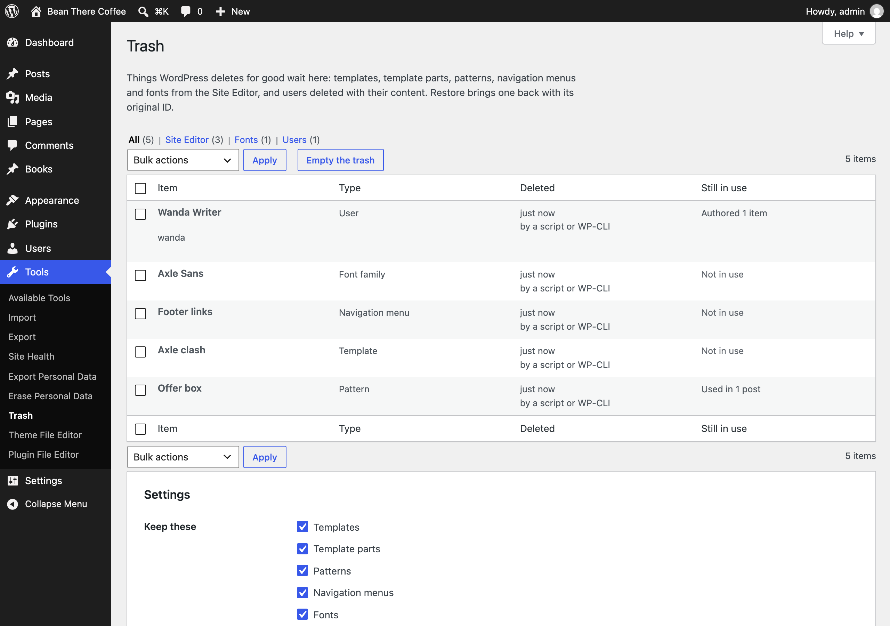
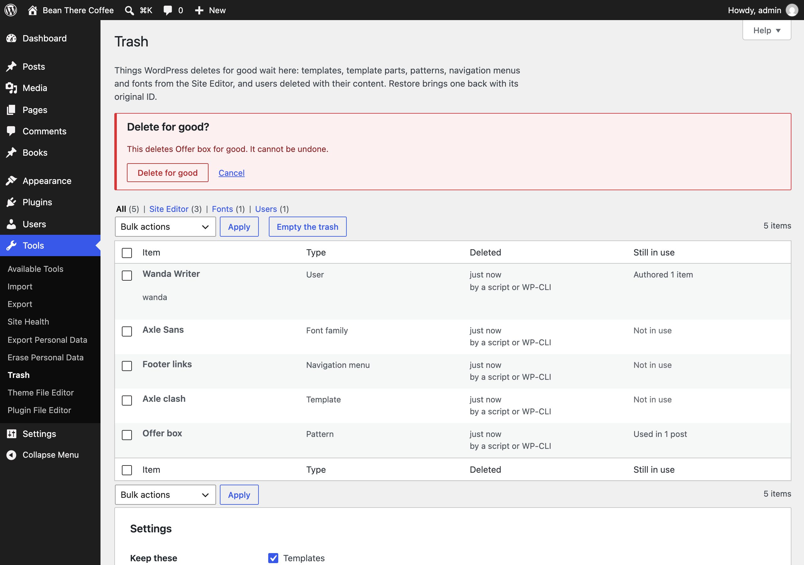
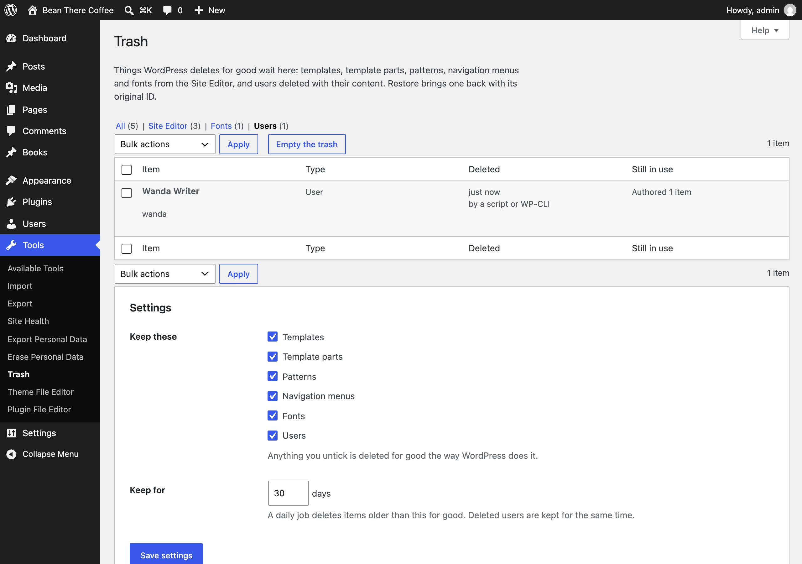
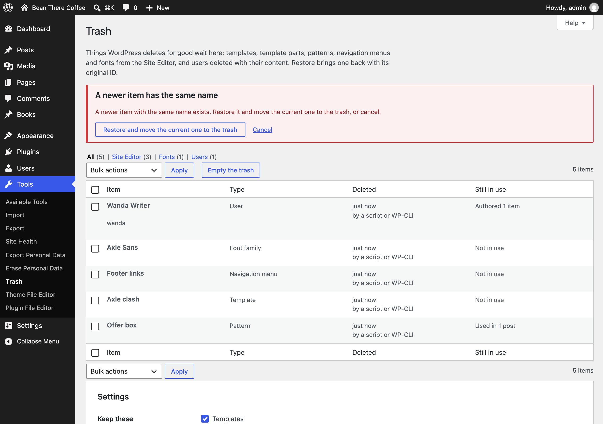
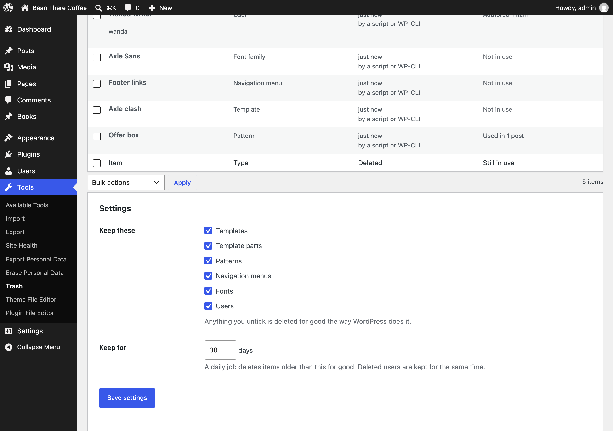

<p align="center"></p>

<h1 align="center">Axle Trash</h1>

<p align="center">
  <a href="https://playground.wordpress.net/?blueprint-url=https://raw.githubusercontent.com/aryanjasala/axle-trash/main/blueprint.json"></a>
  <a href="https://github.com/aryanjasala/axle-trash/releases/latest"></a>
  
  
  <a href="LICENSE.md"></a>
  <br>
  <a href="https://github.com/aryanjasala/axle-trash/actions/workflows/phpcs.yml"></a>
  <a href="https://github.com/aryanjasala/axle-trash/actions/workflows/phpstan.yml"></a>
  <a href="https://github.com/aryanjasala/axle-trash/actions/workflows/unit-tests.yml"></a>
  <a href="https://github.com/aryanjasala/axle-trash/actions/workflows/e2e-tests.yml"></a>
  <a href="https://github.com/aryanjasala/axle-trash/actions/workflows/plugin-check.yml"></a>
</p>

<p align="center">Templates, patterns, menus, fonts and deleted users wait in a trash, and come back with the same ID.</p>

<p align="center">
  
</p>

---

WordPress has no trash for most of what the Site Editor deletes. Delete a template, a template part, a synced pattern, a navigation menu or a font, and it is gone, with its font files. Delete a user with "Delete all content" and every custom post and every upload they made goes with them. Rival plugins can undo some of it, but they bring it back under a new ID, so every page that pointed at it still breaks. Axle Trash catches these deletes, parks the item with its ID, and shows the page it left behind: what used it, who deleted it, and when. Restore puts it back exactly as it was. Nothing leaves your site, and a deleted user's password is never kept.

> [!NOTE]
> Free and open source under the GPL. No pro version, no upsells, no ads in wp-admin, no tracking. And it stays that way.
>
> Part of [Axle](https://axlewp.com/) by AryanX, a family of free plugins for running WordPress sites safely.

## Features

- **Site Editor items are parked, not deleted.** Templates, template parts, patterns (synced or not), navigation menus and font families with their faces. The editor shows "Moved to the Axle trash" with Undo
- **The original ID comes back.** Every `ref` in your posts and templates works again after a restore, because the row never went away. A parked item is gone from the front end and from every query
- **Users deleted with their content.** The account and everything core would have deleted for good (custom posts, attachments with their files) wait together. Restore brings the user back with the same ID, login, email and meta, and their content with them
- **Tools > Trash** with views for Site Editor, Fonts and Users, who deleted what and when, and what still uses it ("Used in 34 posts"). Restore, Delete permanently with a confirm step, bulk actions, Empty the trash
- **Name clashes are handled.** If a newer template took the same name, Restore offers to move the newer one to the trash
- **Only what you could have deleted.** Each kind checks its own capability, per item. Nobody sees, counts or restores an item they could not have deleted
- **30 days by default**, then a daily job deletes for good, font files included. Retention and kinds are settings
- **WP-CLI, REST, abilities, Site Health, privacy tools and hooks** for every part. Deleting the plugin finishes the parked deletes, so nothing stays hidden

## Install

1. Download `axle-trash.zip` from the [latest release](https://github.com/aryanjasala/axle-trash/releases/latest).
2. In WordPress, go to **Plugins > Add New Plugin > Upload Plugin**, choose the zip and activate it.

Or with WP-CLI:

```sh
wp plugin install https://github.com/aryanjasala/axle-trash/releases/latest/download/axle-trash.zip --activate
```

Needs WordPress 6.6+ and PHP 7.4+. To try it first, the **Try in WordPress Playground** badge opens a throwaway WordPress in your browser with the plugin and some demo content.

## Quick look

Delete a synced pattern in the Site Editor. It disappears from the posts that used it. Open Tools > Trash and press Restore, or from a terminal:

```sh
wp axle-trash list
# id   kind     title      deleted_by  deleted_at           used
# 412  pattern  Offer box  Aryan       2026-11-20 09:12:03  Used in 3 posts

wp axle-trash restore 412
# Success: Restored.
```

## Screenshots

<table>
  <tr>
    <td width="50%" valign="top"><br><sub>Deleting for good asks first and says it cannot be undone</sub></td>
    <td width="50%" valign="top"><br><sub>The Users view: a deleted account with the content that was deleted with it</sub></td>
  </tr>
  <tr>
    <td width="50%" valign="top"><br><sub>A newer template took the same name: restore it and move the newer one to the trash, or cancel</sub></td>
    <td width="50%" valign="top"><br><sub>The settings card: which kinds are kept and for how many days</sub></td>
  </tr>
</table>

## Documentation

| Doc | What it covers |
| --- | --- |
| [Reference](docs/REFERENCE.md) | What gets parked, the Trash screen, retention, hooks, WP-CLI, REST, abilities, privacy and data |
| [Development](docs/DEVELOPMENT.md) | Local setup, commands and tests |
| [Contributing](docs/CONTRIBUTING.md) | Pull requests, required checks and PR titles |
| [Releasing](docs/RELEASING.md) | How merged pull requests become releases |
| [Security](docs/SECURITY.md) | Reporting a vulnerability |
| [readme.txt](readme.txt) | What WordPress.org shows, with the FAQ and changelog |

## Project structure

```
axle-trash.php           plugin header and PSR-4 autoloader
uninstall.php            finishes parked deletes, removes options and cron
assets/undo.js           the editor snackbar with Undo
src/
├── Plugin.php           creates the services
├── Status.php           the axle_trash status, the snapshot type, meta keys
├── Upgrade.php          one-time data changes (blanks old password hashes)
├── Kinds.php            kinds, views, per-kind capabilities
├── Settings.php         kinds kept, retention
├── Interceptor.php      pre_delete_post, pre_delete_attachment, delete_user
├── Trash.php            park, restore, conflicts, purge
├── Users.php            account snapshot and restore
├── Items.php            what is parked, cut down to what the person may see
├── Usage.php            "Used in 34 posts"
├── Retention.php        the daily purge
├── Editor.php           loads the Undo script
├── Privacy.php          policy text, exporter, eraser
├── Abilities.php        list, restore, delete
├── Admin/Page.php       Tools > Trash
├── Admin/ItemsTable.php the list
├── Admin/Notices.php    Undo after Users > Delete
├── Cli/Command.php      wp axle-trash
├── Health/SiteHealth.php
└── Rest/Controller.php  POST items/{id}/restore
```

## More free plugins

Small plugins that each fill one gap in WordPress, all free with no pro version. Try them all together at [demo.axlewp.com](https://demo.axlewp.com/).

| | Plugin | What it does |
| --- | --- | --- |
|  | [Axle Page Template Usage](https://github.com/aryanjasala/axle-page-template-usage) | See which template every page uses, and fix the pages on a missing template |
|  | [Axle Staging Guard](https://github.com/aryanjasala/axle-staging-guard) | Stops staging copies from emailing real people, calling live APIs or getting indexed |
|  | [Axle Category & Tag Trash](https://github.com/aryanjasala/axle-category-tag-trash) | A trash for categories, tags and custom terms, with undo and full restore |
|  | [Axle Read-Only Mode](https://github.com/aryanjasala/axle-read-only-mode) | Read-only mode for WordPress during migrations and deploys |
|  | [Axle Block Restore](https://github.com/aryanjasala/axle-block-restore) | Restore a single block from an old revision, not the whole post |
|  | [Activity Log with Undo](https://github.com/aryanjasala/activity-log-with-undo) | An activity log where every change you can reverse has an Undo button |
|  | [Agent Governance](https://github.com/aryanjasala/agent-governance) | Hold risky AI agent calls for approval, preview what they change, and roll back a session |
|  | [Axle AI Guard](https://github.com/aryanjasala/axle-ai-guard) | See and control every AI call your plugins make: cost, data sent, budgets and a kill switch |
|  | [Axle Config Sync](https://github.com/aryanjasala/axle-config-sync) | Keep settings in git, diff them against the live site, apply with a preview and undo |
|  | [Axle Leftovers](https://github.com/aryanjasala/axle-leftovers) | Find what deleted plugins and themes left behind, see who owns it and why, and clean it up with undo |
|  | [Axle License Tracker](https://github.com/aryanjasala/axle-license-tracker) | See which premium plugins are licensed, which lapsed and stopped getting updates, and what renews when |
|  | [Axle Review](https://github.com/aryanjasala/axle-review) | Share drafts through private links, collect outside feedback as block Notes, and know when an approval is out of date |
|  | [Axle Runtime Doctor](https://github.com/aryanjasala/axle-runtime-doctor) | Check OPcache coverage, the object cache, PHP support and limits, cron and more, with the fix for your host |
|  | [Axle Sessions](https://github.com/aryanjasala/axle-sessions) | See every device signed in, sign out one, and limit sessions per role |
|  | [Axle Smoke Test](https://github.com/aryanjasala/axle-smoke-test) | Check key pages after every update or deploy, see what broke and roll it back |
|  | [Block Doctor](https://github.com/aryanjasala/block-doctor) | Scan the site for broken blocks and fix them in bulk, with undo. See which posts use each block before you switch a plugin off |
|  | [Block Theme Ops](https://github.com/aryanjasala/block-theme-ops) | Find Site Editor changes that override your theme files, merge a theme update into them, reset them, send them to Git, move them to another site or lock them |
|  | [Role Right-Sizer](https://github.com/aryanjasala/role-right-sizer) | Recommends the smallest role each user needs, from what they actually do |
|  | [Update Rehearsal](https://github.com/aryanjasala/update-rehearsal) | Try plugin, theme, core and PHP updates, a new plugin, or life without one, on a disposable copy of your site in WordPress Playground first |

## License

Copyright Aryan Jasala. Licensed under [GPL-2.0-or-later](LICENSE.md).
